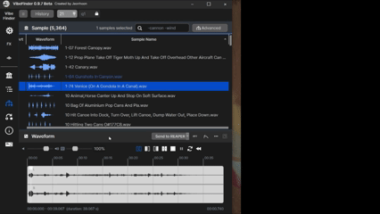
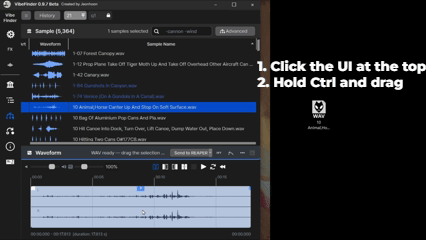

# VibeFinder 0.9.9 Beta

VibeFinder is a Windows audio workflow application for searching and previewing large sound libraries, processing sounds through a VST3 FX Rack, and transferring results to REAPER.

## Get VibeFinder

Visit the [VibeFinder Releases page](https://github.com/jeonhoon528/VibeFinder-Releases/releases) for the latest Windows x64 installer, release notes, and version details.


## Preview

[](https://www.youtube.com/watch?v=dGxa4dQWqgI)

[Watch the VibeFinder preview on YouTube](https://www.youtube.com/watch?v=dGxa4dQWqgI)

## Features

- Fast audio sample library search and management
- Waveform selection and transient-region workflows
- VST3 FX Rack preview
- Nondestructive REAPER transfer and integration
- Tags, folders, notes, settings, and saved layouts
- VibeAnalyzer views for Windows audio output: Waveform, Oscilloscope, Spectrogram, Spectrum, Stereo, and Loudness

## What's New in 0.9.9 Beta

More complete metadata indexing, search filters with autocomplete, detachable sections, and sample columns that fit the panel. After updating, right-click each existing library and choose **Force Rescan** to refresh its metadata.

[Full release notes — English / 한국어](RELEASE-NOTES-0.9.9.md)

## What's New in 0.9.8 Beta

- **More audio formats:** FLAC, AIFF, MP3, and Ogg Vorbis scanning, waveforms, and playback.
- **Playback controls:** stop-position modes (**N**), one-shot selection playback, and Reverse preview.
- **Context Help:** press **F12** and hover over a control for its explanation.
- **Interface and analyzer:** updated sidebar colors/icons, selection text colors, active-section indicators, and analyzer pin behavior.
- **PRISM:** video-link collections, YouTube RSS, collection rename/icon/settings/delete actions, and uninstall record-preservation options.

[Full release notes — English / 한국어](RELEASE-NOTES-0.9.8.md)

## Waveform Selection — Introduced in 0.9.7

- **Select the entire waveform:** Click the waveform or its section header, then press **Ctrl+A**, or simply **double-click the waveform**.
- **Drag without Ctrl:** When the entire waveform is selected, drag its body to your DAW or another supported application without holding Ctrl.
- **Sample selection:** Ctrl+A in the Sample section continues to select all samples.
- **Clear the selection**: Press Esc to deselect the waveform.





## Upgrading from 0.9.4 or earlier

Install `VibeFinder-0.9.8-Beta-User-Setup.exe` once to receive the new updater. Future compatible releases can be installed from within VibeFinder. An older all-users installation is retained until removed separately.

| Action | How to Use |
| --- | --- |
| Download an update | Open **Preferences → Updates & Community** and select **Download update** when a compatible newer release is available. |
| Apply an update | Select **Restart and update** after the download has been verified. |
| Cancel a download | Select **Cancel download** while the update is being downloaded. |
| Read release notes | Select **Current version release notes**. After an in-app update, this page opens automatically once. |


## Library Scanning

| Action | How to Use |
| --- | --- |
| Update a library | **Right-click a library → Rescan Library** to refresh added or changed files while skipping unchanged files. |
| Update a folder | **Right-click a library subfolder → Rescan Folder** to check changes only within that folder. |
| Scan a new subfolder | **Right-click a library → Scan Subfolder…**, then select a folder inside that library. |
| Rebuild file metadata | **Right-click a library or subfolder → Force Rescan** to reread all audio files in that scope, even if unchanged. |
| View progress | The scan window shows added files, files to update, unchanged files, and missing candidates. |

Rescanning still checks the file list in the selected scope. Missing files are marked unavailable only after a completed scan; inaccessible folders and interrupted scans are protected from incorrect missing-file updates. Your notes, tags, and favorites are preserved.

## Installation

1. Download `VibeFinder-0.9.8-Beta-User-Setup.exe` from the [Releases page](https://github.com/jeonhoon528/VibeFinder-Releases/releases).
2. Run the installer and follow the installation instructions.
3. Launch VibeFinder.

### Requirements and Notes

- Supports Windows 10/11, 64-bit.
- Commercial VST3 plug-ins and REAPER are not included.
- This beta is not code-signed. Windows may display an Unknown Publisher or SmartScreen warning.
- Back up important settings and library data before testing a beta release.

## VibeAnalyzer Quick Guide


VibeAnalyzer visualizes Windows audio output using loopback capture. Audio routed exclusively through ASIO or another exclusive device path may not be available to it.

### Controls

| Action | How to Use |
| --- | --- |
| Open or close | Toggle **VibeAnalyzer** from the sidebar. |
| Configure a section | **Right-click** a section to open its settings. Each section can be customized individually. |
| Move the window | **Left-click and drag** a section to move the window. |
| Reorder sections | **Click and hold, then drag** a section to change its position in the section order. |

## Download Integrity

SHA-256 for `VibeFinder-0.9.8-Beta-User-Setup.exe`:

```text
7ce830c89e934b6adffcd04369c4f3dacee20b4d1c8b3259cf5b63f229577340
```

Checksums for the installer, PRISM add-on, and corresponding-source archives are available in `SHA256SUMS.txt` on the Releases page.

## License and Copyright

Copyright © 2026 JEONHOON. All rights reserved.

VibeFinder is proprietary software. The installer and application package include end-user terms and third-party license notices. Corresponding QtBase, QtSvg, and audio codec source archives are provided with the release for license compliance.
